<div align="center">



<sub><code>// se regenera solo cada 6 h con GitHub Actions · sin servicios externos</code></sub>

</div>

### `$ ls ~/proyectos --sort=pushed`

<!--REPOS:START-->
| | Repo | Estado | Lenguaje | Último push | ★ |
|:-:|:--|:--|:--|:--|--:|
| 🟡 | [**VisionporcompuP1**](https://github.com/marcoaurelio-cabral/VisionporcompuP1)<br><sub>proyecto 1 de detecion de caracteres hexadecimales de visión por  computador</sub> | `recent` | — | hace 12 d | 0 |
| ⚪ | [**P00**](https://github.com/marcoaurelio-cabral/P00) | `idle` | — | hace 1 mes | 0 |
| ⚪ | [**dis-p00-marcoaurelio-cabral**](https://github.com/marcoaurelio-cabral/dis-p00-marcoaurelio-cabral) | `idle` | — | hace 2 meses | 0 |
| ⚪ | [**Laboratorio1**](https://github.com/marcoaurelio-cabral/Laboratorio1) | `idle` | C | hace 7 meses | 0 |
| ⚪ | [**IARobots**](https://github.com/marcoaurelio-cabral/IARobots)<br><sub>pryecto final de la asignatura del grupo 4</sub> | `idle` | Python | hace 7 meses | 0 |
| ⚪ | [**LangraphrRepo1**](https://github.com/marcoaurelio-cabral/LangraphrRepo1)<br><sub>repo de pruebas de langraph</sub> | `idle` | Jupyter Notebook | hace 7 meses | 0 |
| ⚪ | [**hackaton**](https://github.com/marcoaurelio-cabral/hackaton)<br><sub>grupo de practicas hackathon para asignatura fisica del entorno</sub> | `idle` | Python | hace 10 meses | 0 |
| ⚪ | [**edamantio**](https://github.com/marcoaurelio-cabral/edamantio)<br><sub>grupo de practicas para asignatura EDA.</sub> | `idle` | C | hace 1 año | 0 |
<!--REPOS:END-->

<details>
<summary><code>$ cat ~/.stack</code></summary>

```text
lenguajes   python · typescript · rust · c · java · sql
ia          anthropic sdk · claude code · agentes
web         react · node
infra       linux · bash · docker · github actions
```

</details>

<details>
<summary><code>$ man marco</code></summary>

```text
NAME
     marco — estudiante de Ingeniería Informática (UFV, Madrid)

DESCRIPTION
     Construye cosas con agentes de IA, gana hackathons de vez en cuando
     y toca la batería cuando el código no compila.

SEE ALSO
     linkedin(1), mail(1)
```

</details>
