<div align="center">



<sub><code>// se regenera solo cada 6 h con GitHub Actions · sin servicios externos</code></sub>

</div>


<details>
<summary><code>$ cat ~/.stack</code></summary>

```text
lenguajes   python · typescript · rust · c · java · sql
ia          anthropic sdk · claude code · agentes
web         react · node
infra       linux · bash · docker · github actions
```

</details>
